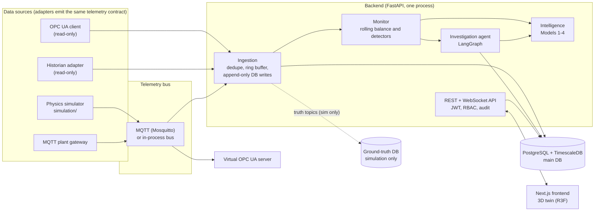

# Architecture

OILINTELLIGENCE is one integrated application built from separate modules. Simulation mode
and plant mode share the same intelligence services; only the data adapter differs.

## Modules

| Module | Path | Responsibility |
|---|---|---|
| Plant definition | `config/plant.yaml`, `industrial/schemas/plant.py` | Single source of truth for geometry, hydraulics, instruments and routes |
| Simulator | `simulation/` | Lumped-parameter physics, instruments, fault injection, records, ground truth, live service |
| Industrial | `industrial/` | Telemetry contract, MQTT bus, OPC UA server and client, historian adapters |
| Intelligence | `intelligence/` | Measurement model, topology-aware balances, uncertainty, Models 1–4, training, evaluation |
| Agent | `agents/` | LangGraph workflow, permissioned tools, evidence grounding, report rendering, optional LLM narrator |
| Backend | `apps/backend/` | FastAPI app, ORM, ingestion, monitoring, simulation control, security |
| Frontend | `apps/frontend/` | Next.js workspaces and the React Three Fiber digital twin |
| Experiments | `experiments/` | Research experiments, ablation, agent evaluation, results report |

The ML engine and the agent run as modules inside the backend process (§10.1). They are
pure-Python libraries with no process boundary, so they can be split into separate
services if scaling ever requires it.

## Data flow

1. **Acquisition.** The simulator, or a plant adapter, publishes telemetry-contract
   records to `oilintelligence/{simulation|plant}/<type>/<asset>/<parameter>` (QoS 1). The
   records layer publishes transfer tickets, proving, calibration, lab and log records.
2. **Ingestion** (`app/services/ingestion.py`):
   - drops duplicate `event_id`s;
   - keeps a 14 h ring buffer and a latest-value cache;
   - batch-appends to `telemetry`, which is never updated;
   - upserts records.

   In simulation mode it writes truth topics to the separate ground-truth database only.
3. **Monitoring** (`app/services/monitoring.py`). Every `MONITOR_INTERVAL_S` of data time,
   the latest `MONITOR_WINDOW_S` window is reconciled:
   - control volumes are rebuilt from meter and valve states;
   - uncertainty is propagated;
   - the detectors run.

   An abnormal window raises, or extends, an anomaly event.
4. **Investigation** (`agents/graph/workflow.py`). The LangGraph state machine runs
   intake → create case → retrieve telemetry → validate quality → recalculate balance →
   attribute → retrieve records → competing explanations → evaluate tests → select action →
   report → request review. Missing critical evidence stops it at `NEEDS_DATA`.
   Verification results and reviews re-enter at `record_outcome`.
5. **Presentation.** REST serves queries and actions. The WebSocket pushes twin state,
   balances, anomalies and investigation updates.

## Safety and trust boundaries

- **Read-only toward the plant.** The OPC UA client and historian adapters have no write
  path. No API endpoint or agent tool commands equipment. Simulation control exists only in
  `DATA_MODE=SIMULATION` and acts on the simulator.
- **Simulation and plant data are separated (FR-018).**
  - Every record carries `source`.
  - A deployment runs in exactly one `DATA_MODE`.
  - The `plant/#` and `simulation/#` topic trees are separate.
  - Ground truth lives in its own database and topic tree, restricted by the ACL.
- **Diagnostic code never sees ground truth.** The intelligence layer takes only telemetry
  and operational records. Ground truth is used only by the Simulation Lab view, the
  simulation verification oracle and the evaluation pipeline.
- **The ML model owns the numbers.**
  - The agent calls deterministic tools and routes between them.
  - The optional LLM writes prose only.
  - A grounding check rejects any narrative that cites a number or tag missing from the
    evidence register.
- **A human approves.** Every report has `requires_engineer_approval = true`. Closing a case
  needs an engineer review, and reviews are audited.
- **Run boundaries.** A simulation run starts from a new initial plant state.
  - Data time never goes backwards between runs: a new run starts after the newest stored
    telemetry.
  - Balances and investigations never span a run boundary.
  - Anomalies are never attached to cases from an earlier run.

## Agent tools (§8.3)

`agents/tools/registry.py`. Every tool has:

- a Pydantic input schema;
- allowed roles;
- a timeout;
- an audit-log entry recording arguments, status, duration and a result summary.

| Tool | Kind |
|---|---|
| get_sensor_history, get_asset_details, get_transfer_history, get_meter_calibration, get_maintenance_records, get_operator_log | Read data |
| calculate_mass_balance, calculate_uncertainty | Deterministic physics |
| run_fault_attribution, evaluate_diagnostic_tests | Models |
| create_investigation, submit_engineer_feedback | Case records |

The report is not a tool. The workflow's `report` node renders it deterministically from the
case state (`agents/reports/render.py`), and the optional LLM narrator only writes the prose
section, which must pass the grounding check.

## Technology choices (locked, §1.1)

| Area | Choice |
|---|---|
| Simulation, backend, ML | Python 3.11, NumPy/SciPy, FastAPI, scikit-learn, XGBoost |
| Probabilistic diagnosis | Closed-form linear-Gaussian Bayesian model; PyTorch was not needed |
| Agent | LangGraph; pluggable LLM (Claude via the Anthropic SDK, or none) |
| Messaging | MQTT (Mosquitto; amqtt embedded for development), OPC UA (asyncua) |
| Storage | PostgreSQL + TimescaleDB (Docker), SQLite (local); SQLAlchemy + Alembic |
| Frontend | Next.js 15, TypeScript, Tailwind, React Three Fiber, Recharts, Zustand |
| Deployment | Docker Compose; Prometheus and Grafana as an optional profile |
