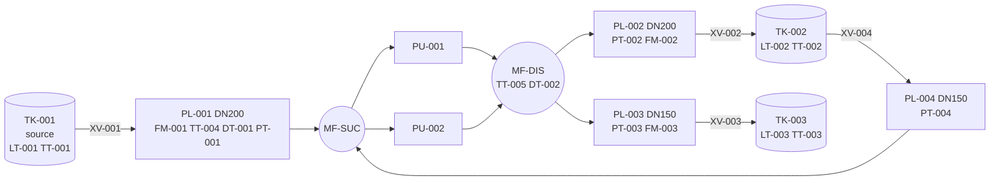

# Process Design Package — Tank Farm TF-01

Phase 1 deliverable (specification §22). The machine-readable source of truth is
[`config/plant.yaml`](../../config/plant.yaml). The simulator, the asset registry, the
3D twin and the measurement model all load that file, so this document describes it
and does not redefine it. If the two disagree, the YAML is correct.

> All values are **synthetic simulation design values**. They are not specifications,
> operating limits or recommendations for any real crude oil facility.

## 1. Tank specifications and geometry

Vertical cylindrical tanks with flat bottoms and fixed roofs. Nominal capacity is
π r² × shell height.

| Tag | Service | Diameter (m) | Shell height (m) | Nominal capacity (m³) | Max safe fill (m) | Min operating level (m) | Initial product |
|---|---|---|---|---|---|---|---|
| TK-001 | Crude source | 28.0 | 16.25 | 10,006 | 15.6 | 1.0 | CRUDE-A |
| TK-002 | Receiving / storage | 25.0 | 16.30 | 8,001 | 15.6 | 1.0 | CRUDE-B |
| TK-003 | Receiving / storage | 25.0 | 16.30 | 8,001 | 15.6 | 1.0 | CRUDE-A |

- Nozzle elevation 0.5 m. Below the minimum operating level, product is treated as dead
  stock and is not pumpable.
- Each tank exchanges heat with ambient air (UA = 4,200 W/K for TK-001, 3,600 W/K for
  TK-002 and TK-003), which drives realistic diurnal temperature drift.
- Strapping is the exact flat-bottom cylinder. Calibration tables, roof and bottom
  geometry are a planned upgrade.

**Products**

| Product | ρ at 15 °C (kg/m³) | α (1/°C) | ν at 15 °C (cSt) | Viscosity temperature coefficient | c_p (J/kg·K) |
|---|---|---|---|---|---|
| CRUDE-A (light sweet) | 850.0 | 0.00085 | 25 | 0.035 | 1950 |
| CRUDE-B (medium) | 862.0 | 0.00082 | 38 | 0.038 | 1930 |

Two products with different densities make transfers change the tank densities. The
measurement model therefore tracks density by mixing, not as a constant.

## 2. Pipelines, diameters and connectivity

| Tag | From → To | DN (mm) | ID (m) | Hydraulic length (m) | Roughness (m) | Σ fitting K |
|---|---|---|---|---|---|---|
| PL-001 | TK-001 → MF-SUC | 200 | 0.2027 | 180 | 4.5e-5 | 6.0 |
| PL-002 | MF-DIS → TK-002 | 200 | 0.2027 | 420 | 4.5e-5 | 9.0 |
| PL-003 | MF-DIS → TK-003 | 150 | 0.1541 | 380 | 4.5e-5 | 9.0 |
| PL-004 | TK-002 → MF-SUC | 150 | 0.1541 | 300 | 4.5e-5 | 6.0 |

Junctions: **MF-SUC** (pump suction manifold) and **MF-DIS** (pump discharge
manifold), both at 0.5 m elevation.

## 3. Pumps and operating parameters

Two identical centrifugal transfer pumps in parallel, MF-SUC → MF-DIS.

| Parameter | PU-001 / PU-002 |
|---|---|
| Head curve | H = H₀ − aQ², H₀ = 85 m, a = 6.6667e-4 m/(m³/h)² (70 m at 150 m³/h) |
| Rated flow / speed | 150 m³/h at 2,960 rpm |
| Efficiency | Parabola peaking at η_BEP = 0.76 at rated flow; motor efficiency 0.94 |
| Start-up time | 6 s |
| Protection | Check valve on each pump; high-level, low-level and low-suction-pressure interlocks in the transfer sequencer |

**Simulated operating points** (mid-transfer, one pump running, normal run):

| Route | Flow (m³/h) | Pump head (m) | Discharge pressure (bar g) | Electrical power (kW) | Control valve opening |
|---|---|---|---|---|---|
| R-01 TK-001 → TK-002 | 127 | 74 | 6.9 | 30.7 | 27% |
| R-02 TK-001 → TK-003 | 107 | 77 | 7.2 | 28.7 | 36% |
| R-03 TK-002 → TK-003 | 94 | 79 | 6.6 | 28.1 | 35% |

Line velocities at these points are 1.1 m/s (PL-002) to 1.6 m/s (PL-003). These are
typical for crude transfer lines and lie inside the 3–8 bar pressure envelope of
specification §5.2.

## 4. Valves and valid routing configurations

| Tag | Line / position | Role | Characteristic | k_open | Rangeability | Stroke time (s) |
|---|---|---|---|---|---|---|
| XV-001 | PL-001, tank end | Isolation, TK-001 outlet | Equal percentage | 0.8 | 50 | 25 |
| XV-002 | PL-002, tank end | Flow control, TK-002 inlet | Equal percentage | 4.0 | 50 | 30 |
| XV-003 | PL-003, tank end | Flow control, TK-003 inlet | Equal percentage | 4.0 | 50 | 30 |
| XV-004 | PL-004, tank end | Isolation, TK-002 outlet | Equal percentage | 0.8 | 50 | 25 |

**Valid routes.** Every other valve stays closed. A route is valid only when its listed
valves are open and at least one pump runs.

| Route | Source → Destination | Open valves | Lines | Control valve / meter | Custody meter | Meters on route | Setpoint range (m³/h) |
|---|---|---|---|---|---|---|---|
| R-01 | TK-001 → TK-002 | XV-001, XV-002 | PL-001, PL-002 | XV-002 / FM-002 | FM-002 | FM-001, FM-002 | 90–150 |
| R-02 | TK-001 → TK-003 | XV-001, XV-003 | PL-001, PL-003 | XV-003 / FM-003 | FM-003 | FM-001, FM-003 | 80–130 |
| R-03 | TK-002 → TK-003 | XV-004, XV-003 | PL-004, PL-003 | XV-003 / FM-003 | FM-003 | FM-003 | 60–95 |

R-03 has **no independent second meter**: FM-001 is on PL-001, which is isolated during
R-03. The attribution engine knows this. A meter error on FM-003 during R-03 can only be
separated from an inventory error by the tank balances, never by meter-to-meter
comparison.

Flow control is a PI loop on the measured flow of the control meter acting on the
control valve (Kp = 0.0006 per m³/h, Ti = 12 s; loop gain about 0.25). The simulated loop
holds setpoint to σ < 0.4 m³/h.

## 5. Sensor placement and measurement specifications

34 instrument tags. Accuracy is the systematic calibration uncertainty (1σ, drawn once
per run). Noise is the per-reading repeatability (1σ). The full table is in
[the data dictionary](../data_dictionary/data_dictionary.md#instrument-tags).

| Type | Tags | Location | Accuracy (1σ) | Noise (1σ) | Publish period |
|---|---|---|---|---|---|
| Radar level | LT-001…003 | Each tank | 3 mm | 1.2 mm + AR(1) 1 mm, τ = 600 s | 1 s |
| Tank temperature (averaging RTD) | TT-001…003 | Each tank | 0.2 °C | 0.04 °C | 2 s |
| Line temperature | TT-004 (PL-001 at 0.93), TT-005 (MF-DIS) | Meter runs | 0.2 °C | 0.05 °C | 2 s |
| Ambient temperature | TT-006 | Site | 0.3 °C | 0.08 °C | 2 s |
| Line pressure | PT-001 (PL-001 at 0.97), PT-002/003 (discharge lines at 0.05), PT-004 (PL-004 at 0.95) | Lines | 0.02 bar | 0.006 bar | 1 s |
| Flow meter (gross volume + totalizer) | FM-001 (PL-001), FM-002 (PL-002), FM-003 (PL-003) | Lines | 0.25% of reading | 0.15% + 0.05 m³/h | 1 s |
| Density meter (ρ at 15 °C output) | DT-001 (PL-001), DT-002 (MF-DIS) | Lines | 0.5 kg/m³ | 0.15 kg/m³ | 5 s |
| Pump skid | PU-00x-ST / -SP / -PW / -PD | Each pump | Speed 5 rpm, power 1%, pressure 0.02 bar | — | 1–10 s, on change |
| Valve | XV-00x-ZT (position), XV-00x-ZC (command) | Each valve | — | — | 5–10 s, on change |

Flow meters use a 2 m³/h low-flow cut-off. Each flow meter is paired with the
temperature and density instruments its flow computer uses: FM-001 with TT-004 and
DT-001; FM-002 and FM-003 with TT-005 and DT-002.

## 6. Normal operating scenarios

The scenario generator (`simulation/scenarios/scenario.py`) builds random but feasible
transfer schedules:

- Route mix: R-01 40%, R-02 35%, R-03 25%, restricted to routes that keep the source above
  min level + 1 m and the destination below max fill − 1 m.
- Setpoint drawn uniformly within the route's range. Duration 60–140 min. Idle gaps of
  15–45 min.
- One pump, or both pumps at 50% probability when the setpoint exceeds 140 m³/h.
- Tank levels and temperatures start randomly inside the ranges in `plant.yaml`. Ambient
  temperature follows a diurnal cycle (30 ± 6 °C, peak at 14:00).
- Records layer: a transfer ticket from the custody meter's flow computer for every
  movement, meter proving and instrument calibration history, lab density samples and
  operator log entries.

Environment B (generalisation) varies instrument noise (×0.6, ×1.6 or ×2.2) and pushes
setpoints to the edges of the envelope.

## 7. Fault scenarios

Fault onset is anchored to the schedule (after a baseline transfer, before or during a
later one), so that every fault is actually exercised.

| Fault (simulator) | Layer | Environment A severity | Environment B severity | Attribution family |
|---|---|---|---|---|
| METER_BIAS | Instrument | ±0.8–3.0% | ±3.5–5.0% | METER_ERROR |
| METER_DRIFT | Instrument | ±0.3–0.9%/h | ±1.0–1.5%/h | METER_ERROR |
| LEVEL_BIAS | Instrument | ±20–60 mm | ±70–100 mm | LEVEL_ERROR |
| LEVEL_DRIFT | Instrument | ±4–12 mm/h | ±13–20 mm/h | LEVEL_ERROR |
| TEMPERATURE_BIAS | Instrument | ±1.5–4.0 °C | ±4.5–6.0 °C | TEMP_ERROR |
| SENSOR_STUCK | Instrument | 30–90 min | — | SENSOR_STUCK |
| SENSOR_DROPOUT | Instrument | 15–60 min | — | SENSOR_DROPOUT |
| PIPELINE_LEAK | Physical | 4–10 mm hole, 15–85% along line, 0–15 min ramp | 2.5–3.5 mm | PIPELINE_LEAK |
| TANK_LEAK | Physical | 7–14 mm floor hole | 5–6.5 mm | TANK_LEAK |
| VALVE_PASSING | Physical | Seat passing 0.12–0.5% of Cv (×0.45 for isolation valves) | 0.06–0.11% | VALVE_PASSING |
| PUMP_DEGRADATION | Physical | 8–20% head loss, plus efficiency loss | 22–30% | PUMP_DEGRADATION |
| MISSING_TRANSACTION | Accounting | One transfer ticket not booked | — | MISSING_TRANSFER |
| MULTI_FAULT | Mixed | Training pairs: meter bias + pipeline leak, level drift + valve passing, temperature bias + tank leak, meter drift + pump degradation | Unseen pairs: pipeline leak + level bias, valve passing + meter bias, tank leak + meter drift, missing transaction + pipeline leak | — |
| DENSITY_BIAS, SENSOR_NOISE, WRONG_QUANTITY | — | **Environment C only** (never in training) | | Expected answer: UNKNOWN or abstain |

Physical faults change the true process. Instrument faults change only what is reported.
Accounting faults change only the records. Ground truth stores all three separately.

## 8. Process and mass-balance equations

See [mathematical models](../mathematical_models/models.md). In summary:

- Tank: dM/dt = Σṁ_in − Σṁ_out − ṁ_loss. V_obs = V₁₅(1 + α(T − 15)). h = V_obs / A.
  Energy balance with ambient exchange.
- Lines: Darcy–Weisbach with Swamee–Jain friction plus fitting and valve K. Pumps on
  H = H₀ − aQ². Orifice-law leaks. Quasi-steady node-head network solve. Mass routed
  with exact stream mixing; simulated conservation error is about 10⁻⁸ kg.
- Balance: R = M_in − M_out − ΔM_inventory per control volume. Control volumes are cut
  at meters that registered flow and at valves shut for the whole window. Uncertainty
  is σ_R² = J Σ Jᵀ, with shared systematic and reading-error keys.

## 9. Asset topology

The topology graph used at runtime is served by `GET /api/v1/topology`. Its nodes are
assets and sensors; its edges are the physical connections plus the measurement
dependencies.

**Measurement boundaries** (control volumes) are not fixed. They are derived for every
balance window from the meters that registered flow and the valves that stayed closed.
For R-01, the cuts at FM-001 and FM-002 yield three control volumes:

1. TK-001 together with PL-001 up to FM-001.
2. The span from FM-001 through the pump station to FM-002 (no inventory, so the residual
   is pure meter disagreement plus any leak).
3. FM-002 to TK-002.

## 10. Sensor tag and data dictionary

See [data dictionary](../data_dictionary/data_dictionary.md): instrument tags, the
telemetry contract, MQTT topics, OPC UA address space and database tables.

## Design freeze

The process design is frozen at `schema_version: "1.0"` of `plant.yaml`. A change to
geometry, routing or instrumentation requires all of the following:

1. Bump the schema version.
2. Regenerate the synthetic dataset (`oil-experiments --regenerate`).
3. Retrain the models.

Otherwise the learned models and the calibration describe a different plant from the one
being simulated. `datasets/training/dataset_meta.json` records a `plant_hash` of the
validated plant definition next to the run-plan hash, so you can compare it with the hash
of the current `plant.yaml`. The check is manual: nothing enforces it at runtime.
